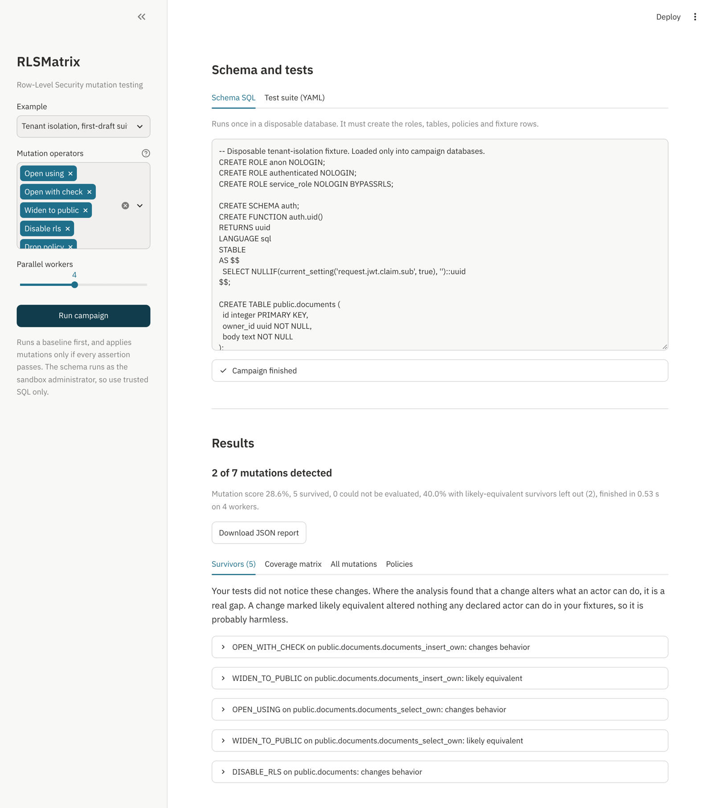
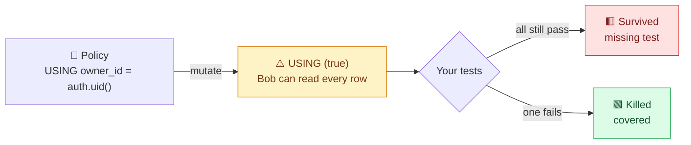
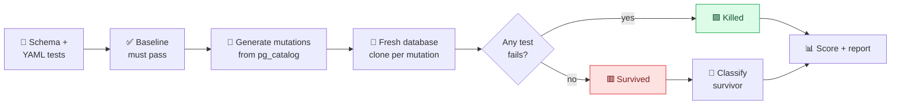
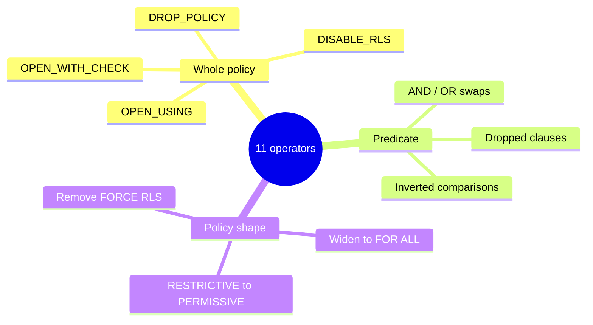
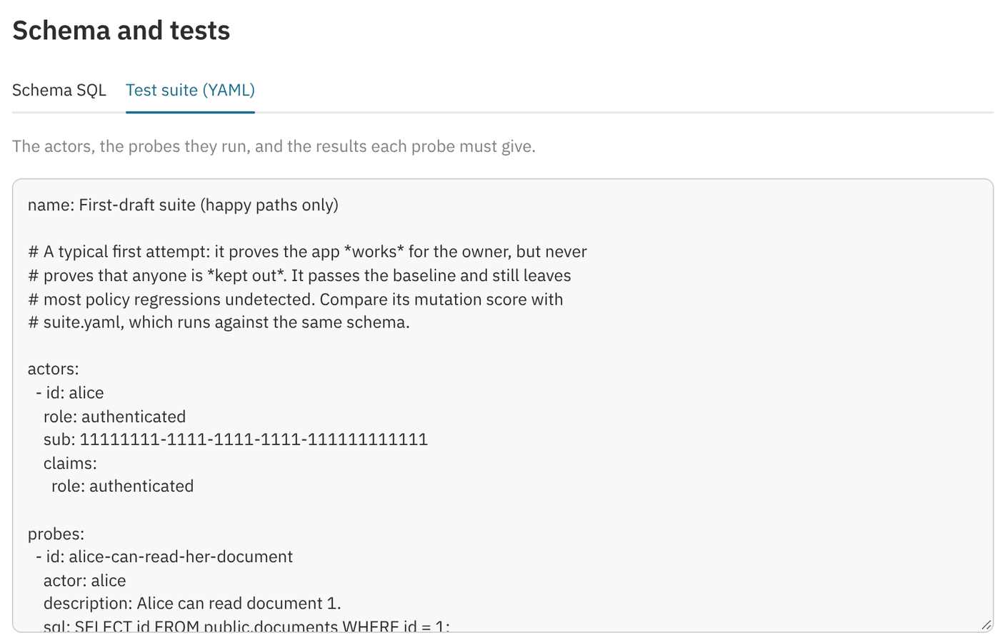
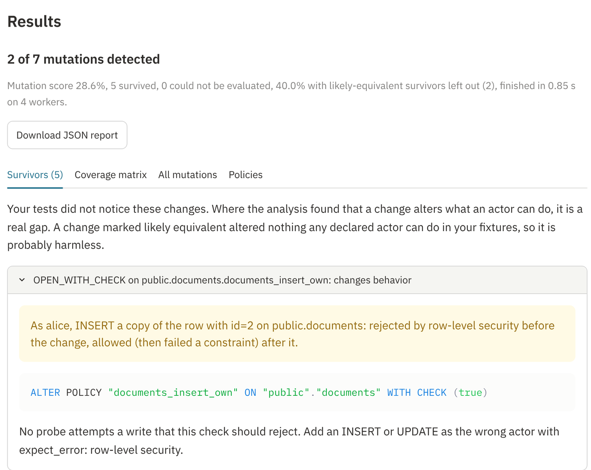
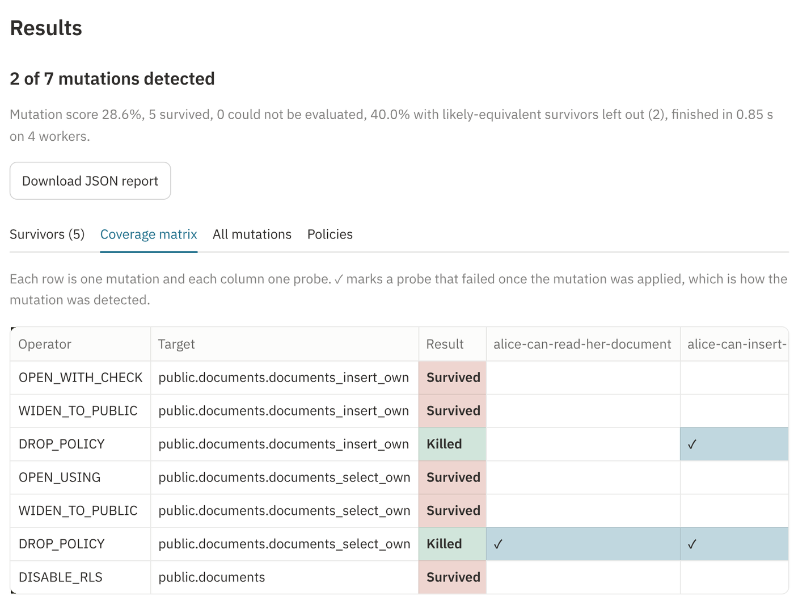
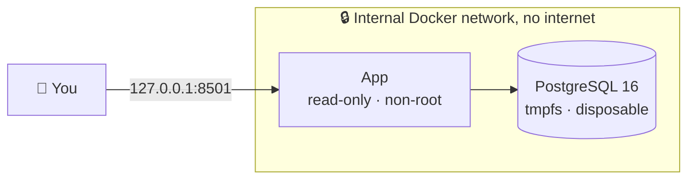

# RLSMatrix

[](https://github.com/rishipx/RLSMatrix/actions/workflows/ci.yml)
[](LICENSE)


**Mutation testing for PostgreSQL Row-Level Security.** RLSMatrix weakens your RLS policies one change at a time and reports every change your tests fail to catch.

<p align="center">
  
</p>

## Why

RLS failures are silent. If a policy is weakened to `USING (true)`, Bob can read every row, but a test that only checks "Alice can read her own document" still passes.



RLSMatrix applies that change and others like it, then lists each one your suite misses.

## How it works



Mutations are rewritten with PostgreSQL's own parser, so every mutant is valid SQL.

| Result | Meaning |
|---|---|
| 🟩 **Killed** | A test failed, so the change was detected. |
| 🟥 **Survived: changes behavior** | Some actor now reads or writes differently. You are missing a probe. |
| 🟨 **Survived: likely equivalent** | No declared actor is affected. Left out of the *adjusted score*. |



```text
mutation score: 28.6%  (2 killed, 5 survived, 0 errors; 7 mutations in 1.7s)
adjusted score: 40.0%  (likely-equivalent survivors left out: 2)
  SURVIVED OPEN_WITH_CHECK  public.documents.documents_insert_own  [changes behavior]
  SURVIVED WIDEN_TO_PUBLIC  public.documents.documents_insert_own  [likely equivalent]
  KILLED   DROP_POLICY      public.documents.documents_insert_own  <- alice-can-insert-her-own-document
  ...
```

## Screenshots

**Write the suite.** Actors and probes are plain YAML, shown next to the schema they run against.



**See what your tests missed.** Each survivor shows the first behavioral difference, the exact SQL change, and the probe to add.



**Check coverage per probe.** The matrix shows which probe killed which mutation, and which mutations no probe noticed.



<details>
<summary><h2>Quick start</h2></summary>

Requires Docker Engine and Docker Compose v2.

```bash
cp .env.example .env
# Set RLSMATRIX_DB_PASSWORD to a unique 24+ character value:
python -c "import secrets; print(secrets.token_urlsafe(32))"

docker compose up --build        # web app at http://localhost:8501
```

Or run from the command line:

```bash
docker compose run --rm app rlsmatrix run \
  --bootstrap examples/tenant_isolation/schema.sql \
  --manifest  examples/tenant_isolation/suite.yaml \
  --min-score 70
```

Add `--operators all` to include predicate and policy-shape operators.

</details>

<details>
<summary><h2>GitHub Action</h2></summary>

```yaml
- uses: rishipx/RLSMatrix@v1.0.0
  with:
    bootstrap: db/schema.sql
    manifest: db/rls-suite.yaml
    min-score: "90"
```

</details>

## Security

RLSMatrix runs the SQL it is given and connects only to its own disposable database. It is not a sandbox for hostile input: run only SQL you trust.



To report a vulnerability, see [SECURITY.md](SECURITY.md).

## Limitations

| Not supported | Detail |
|---|---|
| pgTAP | Tests use RLSMatrix's YAML format. |
| Multi-step probes | A probe is a single SQL statement. |
| Non-policy objects | Operators target policies, not grants, views, functions or triggers. |

## Docs

[Usage](docs/usage.md) · [Writing suites](docs/writing-suites.md) · [Operators and results](docs/results.md) · [CI](docs/ci.md) · [Architecture](docs/architecture.md)

## License

[MIT](LICENSE)
