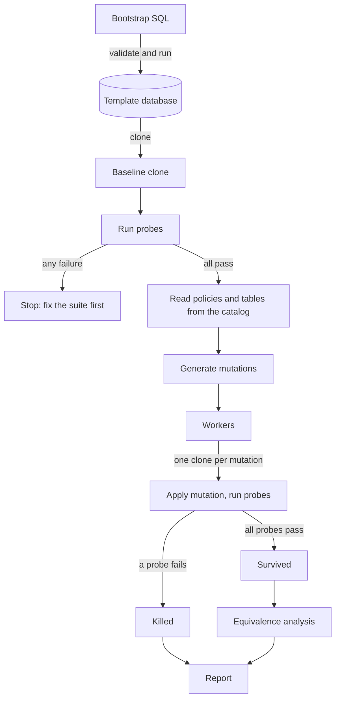

# Architecture

## Campaign flow



| Step | What happens |
|---|---|
| 1. Template | Bootstrap SQL runs once in a fresh database. Statements that touch the cluster, such as `DROP DATABASE`, are refused. Roles the script creates are tracked and removed at the end. |
| 2. Baseline | The template is cloned and every probe runs. If one fails the campaign stops, since results against a broken baseline are meaningless. |
| 3. Mutations | Policies and RLS tables are read from the catalogs and each selected operator produces its mutations, in deterministic order. |
| 4. Evaluation | Each mutation gets its own clone. A worker applies it and runs the probes: a failing probe kills it, otherwise it survives. |
| 5. Assessment | Survivors are compared with the baseline to separate real gaps from harmless changes ([details](results.md#gaps-and-harmless-survivors)). |
| 6. Cleanup | Clones and created roles are removed, even if the campaign is interrupted. |

## Code layout

```text
src/rlsmatrix/
├── cli/            command line: parser, commands, exit codes
├── core/           campaign engine
│   ├── campaign.py     orchestration: template, baseline, workers, report
│   ├── probes.py       run a probe as an actor in a rolled-back transaction
│   ├── equivalence.py  classify surviving mutations
│   └── results.py      result and report models, scoring
├── db/             PostgreSQL access
│   ├── connection.py   connection strings and a reconnecting session
│   ├── sandbox.py      disposable databases, roles and the campaign lock
│   ├── bootstrap.py    validate and run the schema script
│   └── catalog.py      read policies and tables
├── manifest/       YAML suite: models, loader, probe SQL validation
├── mutations/      operators, predicate mutation (pglast), generator
├── reporting/      text and Markdown reports
├── ui/             Streamlit app, presets, tables, fonts
├── examples/       bundled schemas and suites
└── config.py       environment settings and limits
```

Dependencies run one way: `cli` and `ui` use `core`, which uses `db`, `manifest` and `mutations`. Nothing below `cli` or `ui` imports them.

## Design notes

| Decision | Rationale |
|---|---|
| **Clone, don't replay** | Each mutation runs in a fresh clone of one template, so mutations cannot affect each other and no state needs resetting. Cloning costs tens of milliseconds, which makes parallel workers practical. |
| **Rollback is not enough** | Sequence values and some side effects survive a rollback. Isolation comes from the disposable databases. |
| **Roles are cluster-wide** | Roles created by the bootstrap script are shared by every database in the cluster, so they cannot be isolated per mutation. They are removed at the end, and a PostgreSQL advisory lock allows one campaign at a time across the CLI and web app. The lock is released if the holding process dies. |
| **Few connections** | Each mutation uses one maintenance connection to create and drop its clone, and one to apply the mutation, run probes and assess a survivor. A short poll waits for the session to end before the drop, because `DROP DATABASE` re-checks for other sessions only every 100 ms. |
| **An error is not a survival** | A mutation that cannot be applied, or a probe that cannot run, yields `ERROR` and is left out of the score. Counting it as a survivor would hide real problems and inflate the score. |
| **Equivalence is advisory** | The analysis compares behavior in your fixtures and never changes the plain score. |

## Safety model

RLSMatrix runs SQL you give it, so isolation is structural.

| Boundary | Control |
|---|---|
| **Network** | Connects only to the `postgres` service of its own Compose project: no published port, internal network with no internet, data on `tmpfs`. |
| **Credentials** | No hardcoded password. Compose refuses to start without one, and the program rejects short or placeholder values. |
| **SQL** | Bootstrap SQL is parsed before it runs and may not touch the cluster. A probe must be exactly one `SELECT`, `INSERT`, `UPDATE` or `DELETE`. |
| **Execution** | Probes run as the declared role, in a rolled-back transaction, with statement and lock timeouts. |
| **Teardown** | Every sandbox name has a fixed prefix, and teardown refuses names that do not match it. |
| **Container** | The web app binds to `127.0.0.1`. The container runs as non-root with a read-only root filesystem. |

Even so, run only SQL you trust, and never reuse the sandbox password elsewhere.
