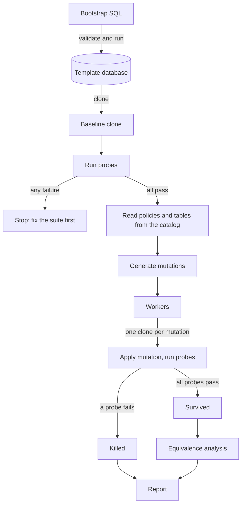

# Architecture

## How a campaign runs



1. **Template.** The bootstrap SQL runs once, in a fresh database called the template. Statements that touch the cluster, such as `DROP DATABASE`, are refused. Roles the script creates are tracked and removed at the end.
2. **Baseline.** The template is cloned and every probe runs. If one fails, the campaign stops, because mutation results are meaningless against a broken baseline.
3. **Mutations.** Policies and RLS tables are read from the catalogs, and each selected operator produces its mutations. Order is deterministic.
4. **Evaluation.** Each mutation gets its own clone of the template. A worker applies the mutation and runs the probes. A failing probe kills the mutation. If all probes still pass it survived.
5. **Assessment.** Survivors are compared with the baseline to tell real gaps from harmless changes (see [Interpreting results](interpreting-results.md)).
6. **Cleanup.** Clones and created roles are removed, even if the campaign is interrupted.

## Code layout

```text
src/rlsmatrix/
├── cli/            command line: argument parser, commands, exit codes
├── core/           campaign engine
│   ├── campaign.py     orchestration: template, baseline, workers, report
│   ├── probes.py       run a probe as an actor in a rolled-back transaction
│   ├── equivalence.py  classify surviving mutations
│   └── results.py      result and report models, scoring
├── db/             PostgreSQL access
│   ├── connection.py   connection strings and a reconnecting session
│   ├── sandbox.py      disposable databases, roles and the campaign lock
│   ├── bootstrap.py    validate and run the schema script
│   └── catalog.py      read policies and tables
├── manifest/       YAML suite: models, loader, probe SQL validation
├── mutations/      operators, predicate mutation (pglast), generator
├── reporting/      text and Markdown reports
├── ui/             Streamlit app, presets, tables and fonts
├── examples/       bundled schemas and suites
└── config.py       environment settings and limits
```

Dependencies run one way: `cli` and `ui` use `core`, which uses `db`, `manifest` and `mutations`. Nothing below `ui` or `cli` imports them.

## Design notes

**Clone, don't replay.** Every mutation runs in a fresh clone of one template, so mutations cannot affect each other and no state has to be reset. Cloning costs a few tens of milliseconds, which is why campaigns parallelize across workers.

**Rollback is not enough.** Probes run inside a transaction that is rolled back, but sequence values and some side effects survive a rollback. Isolation comes from the disposable databases.

**Roles are cluster-wide.** A mutation cannot be isolated from roles created by the bootstrap script, because roles are shared by every database in the cluster. The roles a campaign creates are removed at the end, and a PostgreSQL advisory lock allows one campaign at a time across every process that uses the sandbox, including the command line and the web app. PostgreSQL releases the lock if the process that took it dies.

**Few connections.** Each mutation uses one maintenance connection to create and drop its clone, and one connection to apply the mutation, run the probes and assess a survivor. A short poll waits for the mutation's session to end before the drop, because `DROP DATABASE` re-checks for other sessions only every 100 ms.

**An error is not a survival.** If a mutation cannot be applied or a probe cannot run, the result is `ERROR` and the mutation is left out of the score. Treating it as a survivor would hide real problems and inflate the score.

**Equivalence is advisory.** The analysis compares behavior in your fixtures and never changes the plain score. See [Interpreting results](interpreting-results.md).

## Safety model

RLSMatrix runs SQL you give it, so isolation is structural:

- It connects only to the `postgres` service of its own Compose project, which has no published port. The Compose network is internal, with no internet access, and the database lives on `tmpfs`.
- The password is never hardcoded. Compose refuses to start without one, and the program rejects short or placeholder values.
- Bootstrap SQL is parsed before it runs and may not touch the cluster. Probe SQL must be exactly one `SELECT`, `INSERT`, `UPDATE` or `DELETE`.
- Probes run as the role you declare, in a rolled-back transaction, with statement and lock timeouts.
- Every sandbox name carries a fixed prefix, and teardown refuses names that do not match it.
- The web app binds to `127.0.0.1`. The container runs as a non-root user with a read-only root filesystem.

Even so, run only SQL you trust, and never reuse the sandbox password elsewhere.
